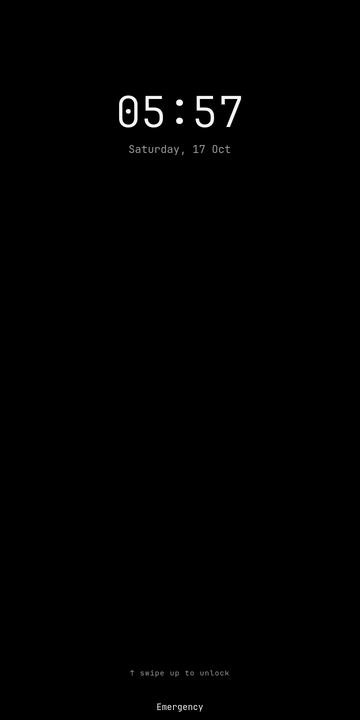
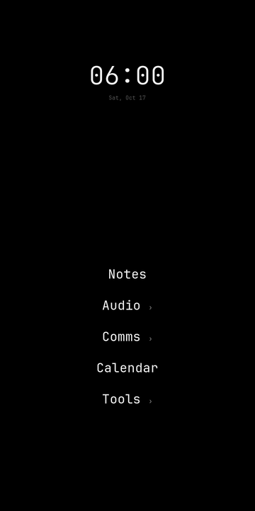
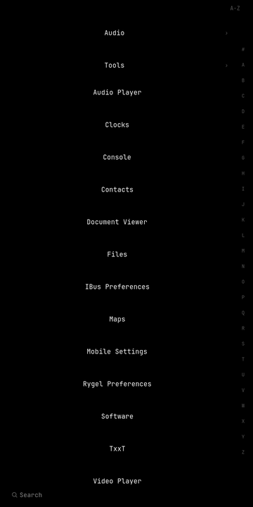
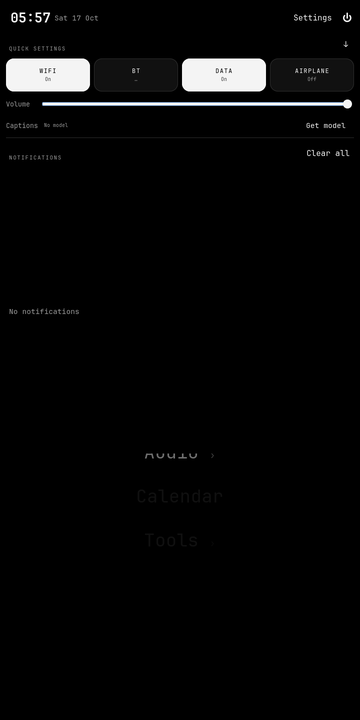

<p align="center">
  
</p>

<h1 align="center">Sphenisca Regia</h1>

<p align="center">
  A Linux phone with no icon grids and nothing phoning home.
</p>

---

## 📱 xx-os

**[xx-os](https://github.com/Sphenisca-Regia/xx-os)** is a complete, minimal phone OS for Linux phones: the
**XX-WM** shell plus nineteen apps that cover what a phone actually gets used for.
Text-first, gesture-driven, AMOLED black. It installs onto an existing mobile
distro. It is not a distro, and it is not GNOME with a theme.

<p align="center">
  
  
  
  
</p>
<p align="center"><sub>Lock, home, drawer, shade. postmarketOS in a VM at 360×720.</sub></p>

- **Runs on phoc** today: postmarketOS, Mobian, FuriOS, PureOS.
- **Heading for the Pixel 9** on Debian, with the shell on river and a docked
  desktop on an external monitor.
- **Python + GTK4/libadwaita**, Rust for the system pieces. Phone-first at
  360×720, usable down to 320 px wide.
- **Local-first.** Config is plain text under `~/.config/xx-wm/`. Captions run on
  the device. Vitals, notes and audiobooks sync to your own server.
- **GPL-3.0.**

### 🧰 What's in the box

| | |
|---|---|
| **Shell** | `xx-wm` home, drawer, shade, lock, calls, notifications, settings, screen time · `xx-keyboard` with QWERTY, Colemak and glide typing |
| **Comms** | `xx-dialer` with call screening and spam blocking · `txxt` SMS/MMS · `xx-contacts` · `xx-email` · `xx-share`, LocalSend-compatible |
| **Daily** | `xx-calendar` · `xx-clock` · `xx-note` · `xx-weather` · `xx-calculator` · `xx-files` · `xx-auth` (TOTP, Aegis vaults) |
| **Media** | `xx-radio` · `xx-audiobook` for your own server |
| **Extras** | `xx-captions`, live captions on the device · `xx-vitals` · `xx-auto` for the car mount · `xx-find` |

Every app is its own meson project with its own tests. They talk over D-Bus.

---

## 🛠️ Help wanted

One person built this. It needs more hands, and more phones.

- **Run it on real hardware.** Fairphone 5, Librem 5, FLX1, PinePhone, anything
  running phoc. Open an issue with the device, the OS and what broke.
- **Pixel 9 bring-up.** Tensor G4 on mainline Linux: display, touch, modem,
  audio. If you've booted a `zumapro` phone, we want to hear from you.
  The plan is in [`docs/pixel-9-bringup.md`](https://github.com/Sphenisca-Regia/xx-os/blob/main/docs/pixel-9-bringup.md).
- **xxwm, in Rust.** The river window manager behind the phone layout and the
  docked desktop.
- **Apps, in Python + GTK4.** Fix what's there, or take a port that's next in line:
  `xx-maps` (offline navigation), `xx-camera`, `xx-photos` (Immich).
- **Design and copy.** Text over icons, one accent, black backgrounds. If you can
  make a 320 px screen read better, do it.

Get set up:

```sh
git clone https://github.com/Sphenisca-Regia/xx-os && cd xx-os
python3 -m venv --system-site-packages .venv && .venv/bin/pip install pytest ruff
sh scripts/check-all.sh          # every project's tests + lint
sh scripts/check-all.sh txxt     # just one
```

Small PRs get read first. For anything big, open an issue before you start.

---

## 🧪 Coming soon

- **Android.** The xx suite on Google Play: notes, mail, maps, camera, keyboard,
  audiobooks and the rest. Each app stands on its own; no home server required.
- **iPhone.** Native SwiftUI, starting with `xx-chat`.

---

<p align="center"><sub>Built by <a href="https://github.com/PiercingXX">PiercingXX</a>. Opinionated on purpose.</sub></p>
